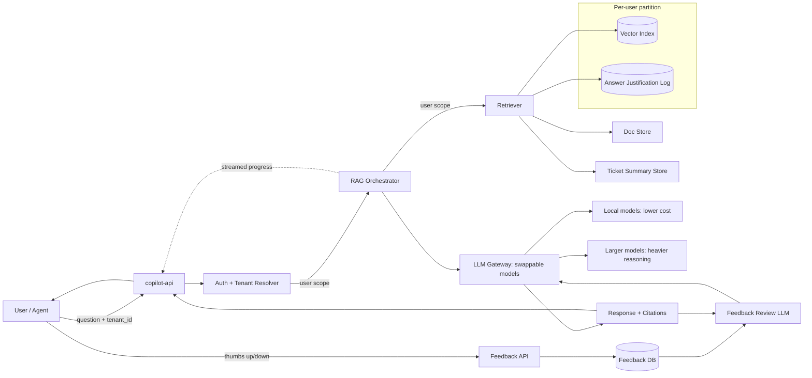

# PLAN

## A — Current state

<!-- 3–6 bullets on what is broken and what matters most. -->

Per the pre-read's observed symptoms:

- **Tenant isolation:** a response cited another tenant's KB article; root cause unknown. *→ Week 1 start; Z: per-user partitioning*
- **Quality:** answers are plausible but ungrounded; citations often irrelevant. *→ B: Feedback Review LLM*
- **Latency and cost:** p95 spikes to 3–5s in bursts; token usage high, likely from large contexts. *→ Proposal: stream progress to the user (latency); cost deprioritized, see Decision log*
- **Observability:** logs are unstructured; we can't explain why a given answer was produced. *→ B: Answer justification at the Retriever*
- **Feedback loop:** thumbs-down is captured but unused; no eval gating before releases. *→ B: Feedback Review LLM*

## B — Next 2-week milestone

<!-- What ships in 2 weeks that measurably moves the North Star, and why it is the best next move given constraints. -->

Ship the low-hanging fruit for quality and understandability:

- **Feedback Review LLM** wired to the LLM Gateway, using captured feedback to review responses. *Addresses: Quality, Feedback loop.*
- **Answer justification at the Retriever**, tying each answer to the sources behind it. *Addresses: Observability.*

## Z — 6–12 month direction

<!-- What the mature system looks like, and how B stays on the upgrade path. -->

- **Per-user data partitioning:** each user has their own Vector Index and Answer Justification Log, with the resolved scope enforced from Auth + Tenant Resolver through to the Retriever.

## Proposal: architecture delta

<!-- What you would add or change, as an updated Mermaid diagram or component-change bullets. -->

- **Add a feedback review LLM, wired to the LLM Gateway.** It takes in user feedback and reviews responses, closing the feedback loop and addressing answer quality.
  - **Open decision: where the reviewer runs.**
    - *Inline:* in the request path, reviewing each response before it reaches the user.
    - *Offline:* outside the request path, reviewing past responses and feedback, then feeding what it learns back to the gateway.
- **Add answer justification for observability.** Logs exist but are unstructured; connect each answer to the sources behind it so we can answer "why did we respond this way?"
  - **Attaches at the Retriever level**, alongside retrieval from the Vector Index, Doc Store, and Ticket Summary Store.
- **Stream progress back to the user while processing.** Show the steps being taken as they happen (e.g. "Reading the docs", "Found a useful doc here"), each expandable for a bit more detail without dumping full output, similar to ChatGPT and Claude. Like a loading bar, visible progress makes users more patient; it also lets them spot when the copilot is going down the wrong track, stop it, and add more information.
- **Make models swappable at the LLM Gateway.** Route to locally hosted models to reduce cost as necessary, and to bigger models when a request needs heavier reasoning.
- **Separate data by user.** Each user gets their own Vector Index and Answer Justification Log; the scope resolved by Auth + Tenant Resolver is carried through the RAG Orchestrator to the Retriever, which only reads and writes that user's partition.

## Sequencing

<!-- Week 1, week 2, optionally weeks 3–6. -->

### Week 1

- **Quality and observability:** answer justification at the Retriever.
- **Data isolation:** start early on the separation work; full per-user partitioning continues toward Z.

### Week 2

- **Feedback loop:** first implementation of the Feedback Review LLM.

### Weeks 3–6

- **Revisit the feedback loop** to verify it once the other pieces are in place.

## Risks and mitigations

<!-- Top risks, each as risk → mitigation. -->

1. **Tenant leakage** → Largely covered by separating data per user. Verify that IDs can never get swapped.
2. **Quality: the Feedback Review LLM itself goes wrong** → Extensive testing, plus the feedback loop we're integrating, which exists for this purpose.
3. **Cost: token usage higher than expected** → Wait it out as inference costs fall (see Decision log).
4. **Observability: the structured justification misses something** → Relies on the Vector Index doing what it should.

## Validation plan

<!-- Success metrics (North Star plus leading indicators), evaluation and monitoring, and rollout. -->

LLM evaluation and alignment is a hard, unsolved problem even for the largest companies, so we validate by using the system heavily ourselves and pushing its boundaries.

- **Dogfood it:** if we build it, we use it, as much as possible.
- **Adversarial testing:** ask for things that don't exist, including things that exist only in another tenant's data, to confirm the isolation wiring can't leak.
- **Time responsiveness:** track average time to first feedback, and confirm streamed progress arrives roughly every second.
- **Test the reasoning:** ask tricky questions to confirm the streamed reasoning is sound.

## Decision log

<!-- What you said no to and why, the biggest tradeoff you made, what you would validate first, and what you would do with one more week. -->

- **Attack the simple things first:** square away cross-contamination, address the quality concerns, then add an additional quality layer (the Feedback Review LLM).
- **Streaming for latency:** stream progress back to the user to address the latency piece.
- **Swappable models, no new vendors:** keep the option to switch models if and when it becomes necessary, without procuring new vendors; good free models are available.
- **Hooked up the feedback loop:** thumbs-down feedback now feeds the Feedback Review LLM instead of going unused.
- **Said no to: prioritizing infrastructure cost.** Cost per inference is falling quickly, so we focus on quality and insight into answers rather than infra cost. Streaming progress doesn't change cost, and it reduces latency from the user's point of view by giving feedback as we go.
- **Going forward:** the feedback loop is the most important piece to build on; use reinforcement learning from human feedback (RLHF) there.
